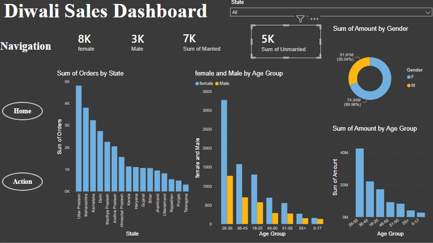
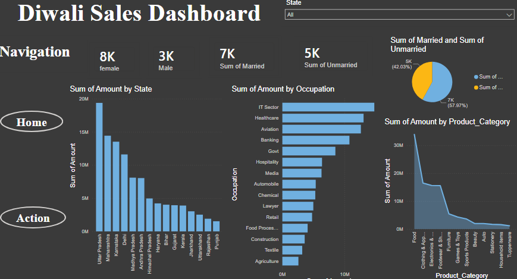

# 🪔 Diwali Sales Dashboard – Power BI

## 📌 Project Overview

The **Diwali Sales Dashboard** is an interactive data visualization project built using Microsoft Power BI to analyze sales performance during the Diwali festival season. It provides insights into sales trends, customer demographics, product categories, and purchasing behavior to support better business decisions.

## 🎯 Objectives

- Analyze overall sales performance during the Diwali season.
- Identify top-performing product categories and products.
- Understand customer purchasing behavior based on gender, age group, and occupation.
- Analyze sales across states and regions.
- Provide actionable insights to improve marketing strategies and sales performance.

## 🛠️ Tools & Technologies

- **Power BI** – Dashboard creation and data visualization.
- **Microsoft Excel / CSV** – Data storage and preprocessing.
- **Power Query** – Data cleaning and transformation.
- **DAX** – Measures and calculations for sales analysis.

## 📊 Dashboard Preview

### 🏠 Home Page

The Home page provides an overview of Diwali sales performance through interactive visuals and key performance indicators (KPIs).

**Key features:**

- Overall sales and order summary.
- Customer and product insights.
- Sales performance overview.
- Interactive navigation to explore different dashboard sections.



### ⚡ Action Page

The Action page provides detailed sales analysis and insights to support data-driven decision-making.

**Key features:**

- Sales analysis by gender and age group.
- State-wise sales performance.
- Occupation-based customer analysis.
- Product category and purchasing trends.
- Interactive filters and slicers for detailed exploration.



> **Note:** Replace the image paths above with the actual paths of your preview images in your GitHub repository.

## 🔍 Key Insights

The dashboard can help identify:

- Customer segments contributing the most to sales.
- States and regions generating higher sales.
- Popular product categories during Diwali.
- Purchasing patterns across different age groups and occupations.
- Opportunities to improve promotions and customer targeting.

_Add your actual findings here after analyzing the dashboard data._

## 🚀 How to Use

1. Clone or download this repository.
2. Open the `.pbix` file using Microsoft Power BI Desktop.
3. Refresh the dataset if required.
4. Explore the Home and Action pages.
5. Use filters and slicers to analyze sales data interactively.

## 📁 Project Structure

```
Diwali-Sales-Dashboard/
│
├── README.md
├── Diwali_Sales_Dashboard.pbix
├── dataset/
│   └── diwali_sales_data.csv
└── images/
    ├── home.png
    └── action.png
```

_Update the file and folder names to match your actual repository._

## 💡 Business Recommendations

- Focus marketing campaigns on high-performing customer segments.
- Promote popular product categories during festive seasons.
- Use regional sales trends to optimize inventory distribution.
- Develop targeted offers based on customer purchasing behavior.
- Monitor sales KPIs to evaluate promotional effectiveness.

## 👨‍💻 Author

**Your Name**

- GitHub: [https://github.com/Jaya-Manusha]

## ⭐ Acknowledgment

This project was created to demonstrate data cleaning, data modeling, interactive dashboard development, and business intelligence skills using Power BI.

If you find this project useful, consider giving the repository a ⭐ on GitHub\!
